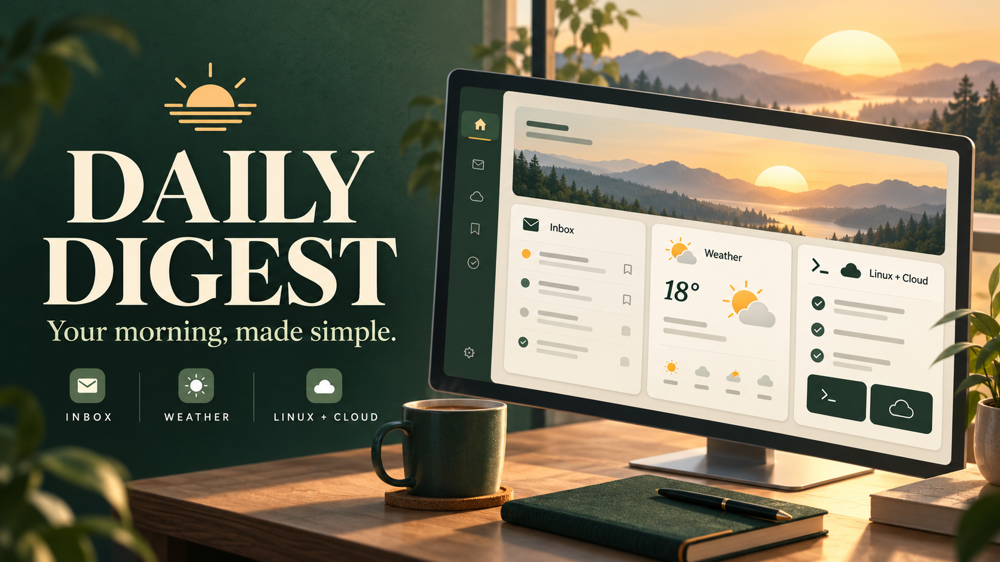

# My Daily Digest

A private morning briefing app built for Jason Edwards. It combines Gmail priorities, Mims weather, and Linux/cloud updates in a calm dashboard.

## Features

- Today view with priorities, weather, actionable stories and source timestamps.
- Durable digest history and bookmarks in SQLite/Cloudflare D1.
- Saved source preferences and reading-length choices.
- Manual public-source refresh from the National Weather Service and official Fedora, Ubuntu and AWS feeds.
- Markdown and JSON downloads, plus a print layout for PDF export.
- A responsive layout for desktop and phone.
- A source ZIP downloadable from the app.
- A private write API for a scheduled ChatGPT task to publish a complete issue, including Gmail results.

## Run the downloaded app locally

Install Node.js 22.13 or newer, then run in this directory:

```bash
npx pnpm install --frozen-lockfile
npm run local
```

Open http://127.0.0.1:8787. The local launcher builds the app, applies migrations, and starts the Worker on loopback. Local data stays in .wrangler/state. No OpenAI API key is needed for the public-source refresh.

The source download intentionally excludes email contents, database files, authentication credentials and deployment identity. A new local copy starts with an empty history; use Refresh web to create its first issue.

## Automation and email

The hosted app is updated by the existing **My Daily Digest** ChatGPT task, configured for **7:00 a.m. America/New_York every day**, starting October 27, 2026. Each run reads this app's saved preferences, queries Gmail and current web sources through ChatGPT, then saves an issue to the private app.

The app does not contain Gmail OAuth credentials or send mail. Gmail access uses the connected ChatGPT account. Email notification delivery must be enabled in ChatGPT's task notification settings and was not verified during setup. The app links to ChatGPT for schedule and notification management rather than presenting pretend delivery switches.

A downloaded/local copy does not inherit the hosted schedule or access to Gmail. Relink an authenticated cloud-accessible deployment to a ChatGPT task if you want to update a different deployment automatically. Loopback addresses cannot receive cloud-task updates.

## APIs

- GET /api/state - settings, up to 60 issues, and saved items.
- GET /api/settings / POST /api/settings - get and save source preferences.
- GET /api/digests / POST /api/digests - list and upsert a validated issue.
- POST /api/bookmarks - save or unsave a validated story.
- POST /api/refresh - refresh public weather/news, preserving Gmail's last checked time.

See lib/digest.ts for the exact schemas and AUTOMATION.md for the unattended update contract. New issues use YYYY-MM-DD-am as their ID so retries update the same issue without duplicates.

## Privacy and deployment

**Keep the hosted app owner-private.** All routes rely on Sites dispatch authentication, including service requests. Never deploy it as a public website without adding independent authentication and authorization to every API route. The local launcher binds only to 127.0.0.1.

Connected accounts are read-only. The app saves only its own preferences, issues, and bookmarks. Failed public-source refreshes retain earlier data and identify the limitation; old data is not presented as a successful fresh read.

## Development

```bash
npm test
npx tsc --noEmit
npm run dev
```

Stack: React, TypeScript, Vinext, Cloudflare Workers, Drizzle and D1. Source state is separate from private runtime data. No personal email snapshots are embedded in the code.
